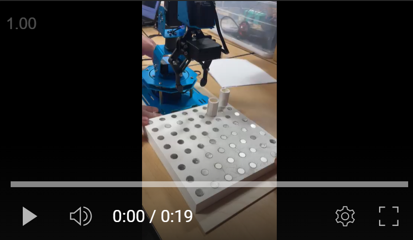

## Chess Playing Robot 

### Introduction
ChessBot is an advanced robotic arm designed to move chess pieces based on user commands, with future integration plans for StockFish, a powerful chess engine. The primary objective is to create an over-the-board training tool that mimics real-life chess play.

### Design
The project is divided into mechanical and software components:

- **Mechanical Design:** The robotic arm is optimized for an 18x18 cm chessboard, using 3D-printed rectangular prism pieces with magnetic bases to ensure stability and precise placement.
- **Software Design:** Inverse kinematics are computed using the SciPy optimization library, enabling the arm to map chessboard coordinates to physical locations. The arm's movements are controlled via a set of predefined waypoints, and the gripper is synchronized to accurately grasp and release pieces.

### Testing
Initial testing revealed alignment and gripping issues, which were resolved through adjustments to the virtual workspace and fine-tuning of the gripper mechanism.

### Results
ChessBot successfully executes user-specified moves on the chessboard. Integration with StockFish remains pending due to time constraints.

### Future Work
Enhancements include integrating computer vision for piece detection and automating move calculations with StockFish.
